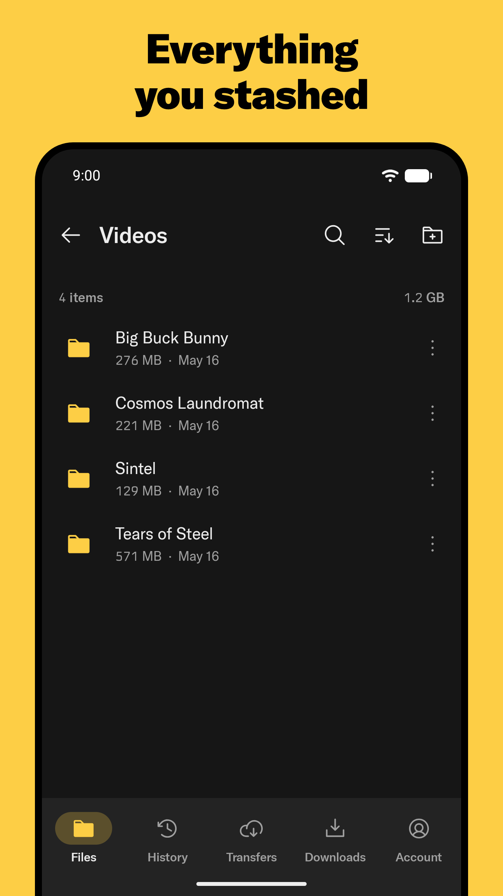
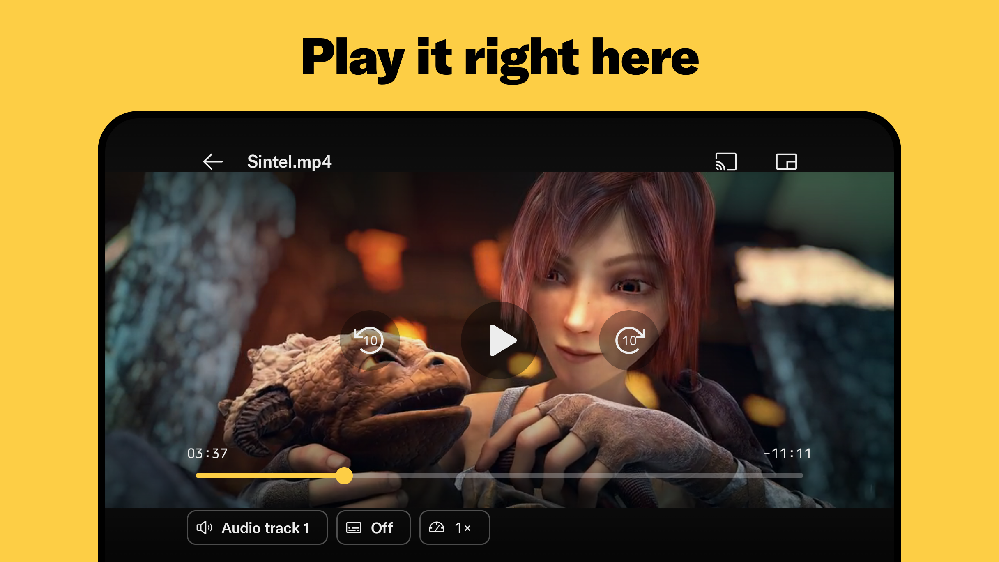
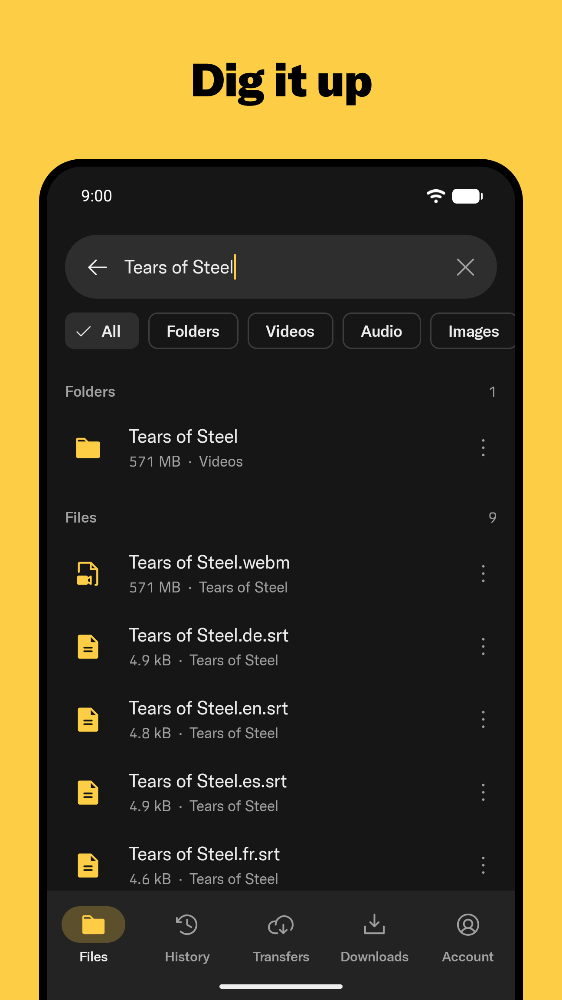
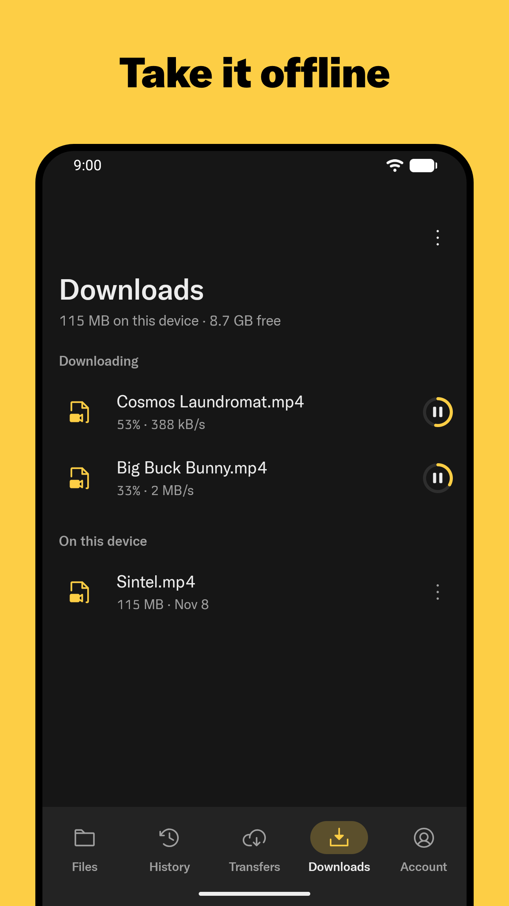
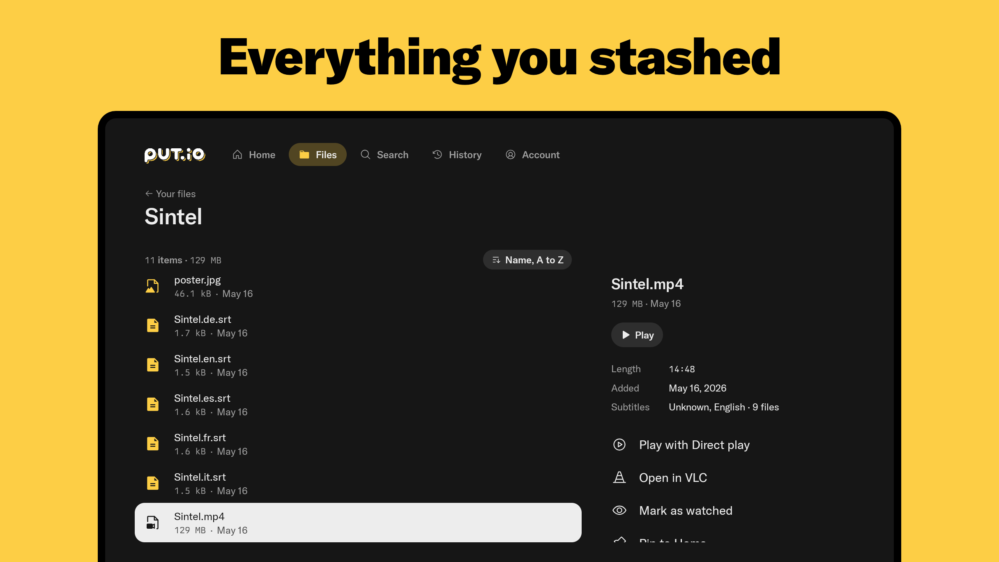

<div align="center">
  <p>
    
  </p>

  <h1>putio-android</h1>

  <p>
    Native Android app for put.io on phones, tablets, Android TV, and Fire TV
  </p>

  <p>
    <a href="https://github.com/putdotio/putio-android/actions/workflows/ci.yml?query=branch%3Amain" style="text-decoration:none;"></a>
    <a href="https://github.com/putdotio/putio-android/blob/main/LICENSE" style="text-decoration:none;"></a>
  </p>
</div>

<p align="center">
  
  
  
  
</p>

<p align="center">
  
</p>

<p align="center">
  <sub>Sintel © copyright Blender Foundation | durian.blender.org</sub>
</p>

## Install

Get the app from [Google Play](https://play.google.com/store/apps/details?id=io.put.putio).

## Use

Sign in with your put.io account to browse, search, and stream your files.

- **Mobile:** Files, Search, History, Transfers, Trash, and Account; offline
  Downloads; video and audio playback with Cast, original files where the
  device decodes them; a widget, shortcuts, and the system file picker.
- **TV:** device-code sign-in, Home, Files, Search, History, Trash, and
  Account; full-screen playback, original files where the device decodes
  them; the launcher's Play Next row and system search.

Crash reports stay on unless Diagnostics is off. Product analytics run only
once the account turns them on.

## Build

Requires JDK 21, Node (`.node-version`), pnpm, `python3`, and, on macOS, Homebrew.

```bash
./scripts/bootstrap.sh
./gradlew verify
./gradlew :mobile:assembleProductionDebug :tv:assembleProductionDebug
```

`bootstrap.sh` runs once per machine. [Build and verify](./AGENTS.md#build-and-verify)
covers the gate and [building against an unreleased SDK](./AGENTS.md#kotlin-sdk).

## Docs

- [Design](./DESIGN.md): the Android design contract
- [Architecture](./docs/architecture.md): module boundaries and main flows
- [Agent guide](./AGENTS.md): hazards, proof map, and CI
- [Security policy](https://github.com/putdotio/.github/blob/main/SECURITY.md):
  report vulnerabilities privately

## License

[MIT](./LICENSE). Release builds bundle FFmpeg and FriBidi, both
LGPL-2.1-or-later, as separate native libraries. See [NOTICE](./NOTICE).
