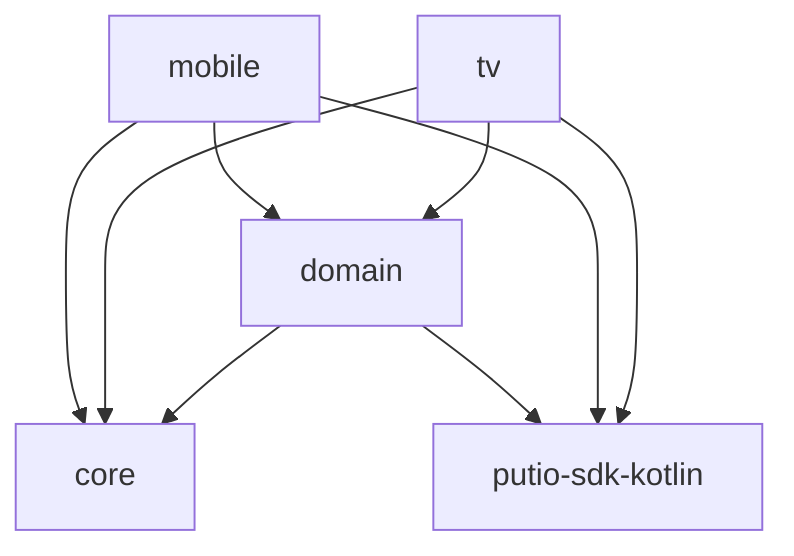
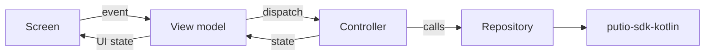
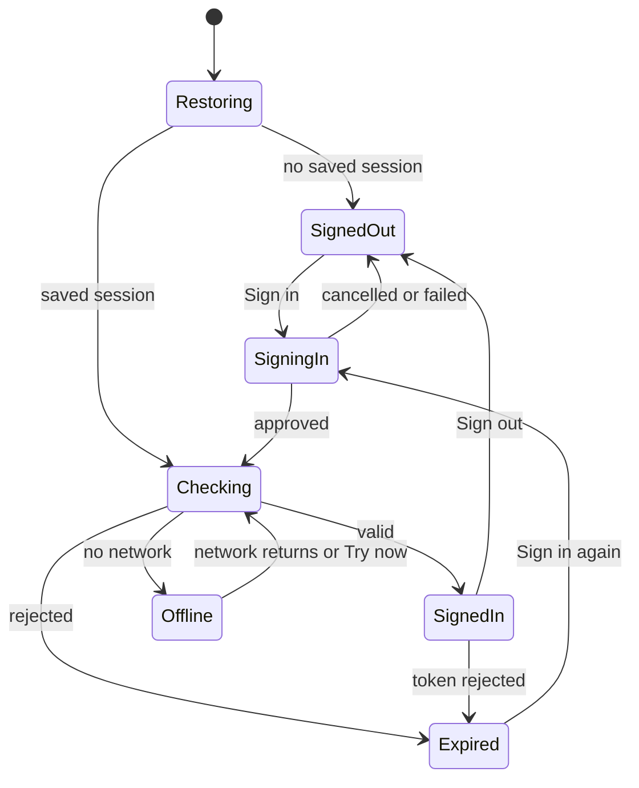
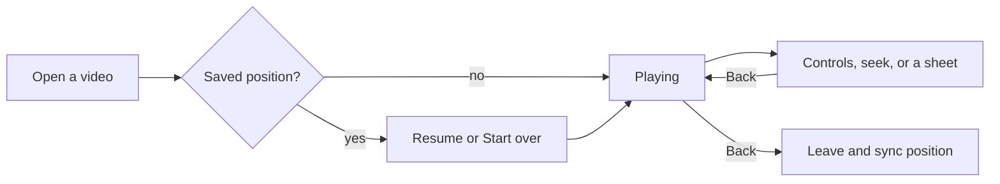

# Architecture

What the apps do and how the code is split. It stays at the level of product
areas and module boundaries. Screen detail lives in the code, its tests and the
Android design canvas; [DESIGN.md](../DESIGN.md) owns the visual contract.

## Apps

One Gradle build ships two apps on one Play identity:

| App      | Form factors           | Input            | Shell                 |
| -------- | ---------------------- | ---------------- | --------------------- |
| `mobile` | Phones, tablets        | Touch, keyboard  | Material 3 Expressive |
| `tv`     | Android TV and Fire TV | D-pad and remote | Compose for TV        |

Both apps share data, domain, theme and component foundations. Their shells
diverge where input differs.

## Modules

- `core:common`: shared failures, network state and small primitives.
- `core:design`: the theme, type and colour generated from `design/` and
  DESIGN.md, plus the shared components.
- `core:telemetry`: crash reporting and product analytics behind the account's
  privacy controls.
- `domain:*`: one module per shared product area (account, auth, files,
  history, playback, search, sharing, transfers, trash), holding its
  controllers, state and repositories. Playback also carries the shared
  subtitle overlay.
- `mobile` and `tv`: navigation, screens, view models, the players, and the
  controllers of areas only one app has, such as sign-in, Downloads and Home
  pins. Each app builds the SDK client and hands it to the repositories.

The [Kotlin SDK](https://github.com/putdotio/putio-sdk-kotlin) is the only API
boundary; a gap closes there, never with app-local HTTP.

## State

A controller owns an area's state as an explicit state machine and is the
only writer. View models subscribe and dispatch events; screens render state
and never call the API. Failures are typed per area and reported as codes,
never as raw messages.

## Session

The shared shape of a session. TV has no signed-out resting state, since it
always shows a device code, and mobile opens a restored session offline on
the last confirmed account.

## Product areas

| Area      | Mobile                                                 | TV                                           |
| --------- | ------------------------------------------------------ | -------------------------------------------- |
| Sign-in   | OAuth in the browser                                   | Device code, also as a QR code               |
| Session   | Secure storage, checked again when the network returns | The same, plus import from the legacy TV app |
| Home      | Continue watching in Files                             | Continue watching and pinned items           |
| Files     | Browse, search, item actions, multi-select             | Browse, search, item actions                 |
| History   | Account events by day                                  | The same                                     |
| Trash     | Restore and delete                                     | The same                                     |
| Transfers | Add, watch and manage                                  | Not on TV                                    |
| Downloads | Offline copies, which never touch the file on put.io   | Not on TV                                    |
| Playback  | Video and background audio, Cast                       | Full-screen video and audio                  |
| Account   | Settings, privacy controls, exclusive links            | Settings and privacy controls                |
| Platform  | Widget, shortcuts, file picker, share targets          | Watch Next, system search, launcher banner   |

## Playback

Media3 plays every stream, HLS or MP4 per the account's setting, with a
media session for system controls. Where VLC is installed, a video the player
can't play, or one still converting, offers Open in VLC; TV offers it on every
video. Play positions sync to put.io, throttled and flushed on exit, never per
progress tick.

Back always closes the topmost layer before it leaves playback.

## Privacy

- Release builds send crash reports to Sentry unless the account turned
  Diagnostics off; they stay on while signed out.
- Product analytics go to PostHog only once the account turns them on, and
  only events on the allowlist in `core:telemetry`.
- Neither sends filenames, titles, URLs, search text or tokens.
- Tokened stream and download URLs go only to the player, VLC or the open-with
  chooser, never to a browser, whose history would keep the token.
