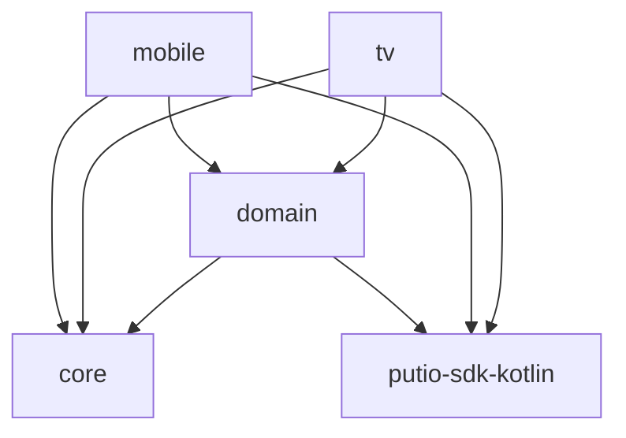
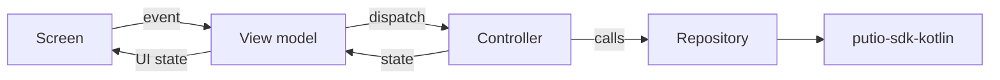
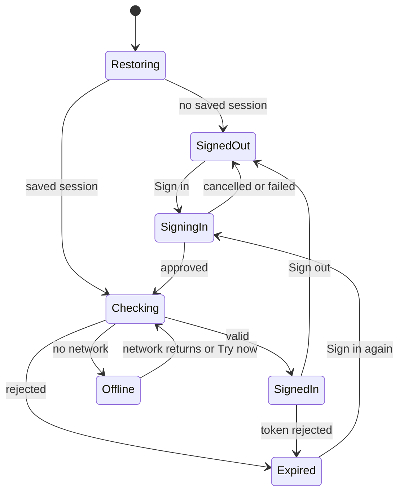
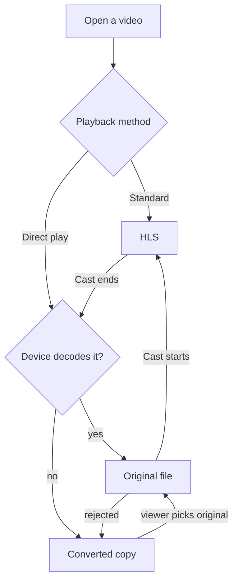
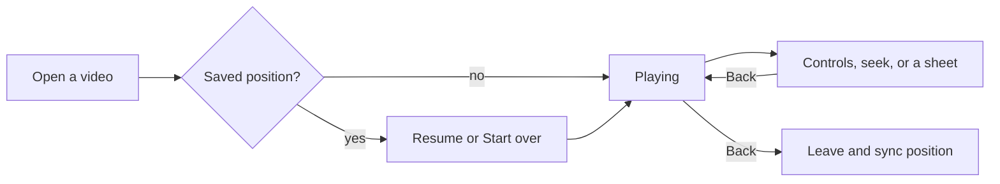

# Architecture

How the code is split and how its main flows run.

## Apps

One Gradle build ships two apps on one Play identity:

| App      | Form factors    | Input            | Shell                 |
| -------- | --------------- | ---------------- | --------------------- |
| `mobile` | Phones, tablets | Touch, keyboard  | Material 3 Expressive |
| `tv`     | Android TV      | D-pad and remote | Compose for TV        |

Both apps share data, domain, theme and component foundations. Their shells
diverge where input differs.

## Modules

- `core:common`: shared failures, network state and small primitives.
- `core:design`: the theme, type and colour generated from `design/` and
  DESIGN.md, plus the shared components.
- `core:telemetry`: crash reporting and product analytics behind the account's
  privacy controls.
- `domain:*`: one module per shared product area (account, auth, files,
  history, playback, search, sharing, transfers, trash), holding its
  controllers, state and repositories. Playback also carries the shared
  subtitle overlay.
- `mobile` and `tv`: navigation, screens, view models, the players, and the
  controllers of areas only one app has, such as sign-in and Downloads. Each
  app builds the SDK client and hands it to the repositories.
- `baselineprofile:mobile`: the macrobenchmark journeys that write the mobile
  app's baseline profile; `scripts/generate-baseline-profile.sh mobile <serial>`
  runs them.
- `baselineprofile:tv`: the macrobenchmark journeys that write the TV app's
  baseline profile; `scripts/generate-baseline-profile.sh tv <serial>` runs
  them.

The [Kotlin SDK](https://github.com/putdotio/putio-sdk-kotlin) is the only API
boundary.

## State

A controller owns an area's state as an explicit state machine and is the
only writer. View models subscribe and dispatch events; screens render state
only. Failures are typed per area and reported as codes.

## Session

The shared shape of a session. While signed out, TV always shows a device
code. Mobile opens a restored session offline on the last confirmed account.

## Playback

Media3 plays every stream with a media session for system controls. The app's
playback method picks the stream, and Standard is the default.

The player rejects an original for tracks the device can't play, a failure
before the first frame, or the viewer's switch; the converted copy starts at
the same position. Direct play can decode audio with bundled FFmpeg after MediaCodec,
and devices with the memory for it draw ASS/SSA subtitles with libass. Play
positions sync to put.io, throttled and flushed on exit.

Back always closes the topmost layer before it leaves playback.

## Privacy

- Release builds send crash reports, native ones included, to Sentry unless
  the account turned Diagnostics off; they stay on while signed out.
- Product analytics go to PostHog only once the account turns them on, and
  only events on the allowlist in `core:telemetry`.
- Neither sends filenames, titles, URLs, search text or tokens.
- Tokened stream and download URLs go only to the player, VLC or the open-with
  chooser; a browser's history would keep the token.
