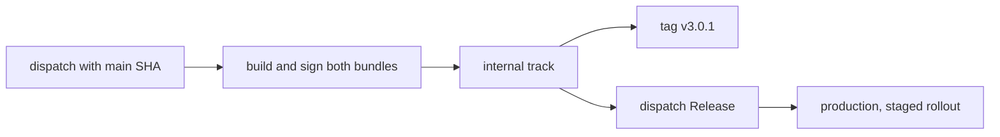

# Distribution

Both apps ship to Google Play by manual dispatch from `main`. A merge deploys
nothing, and no workflow commits a version bump.

- [Google Play Internal](../.github/workflows/play-internal.yml) writes release
  notes, builds and signs both bundles, uploads them to the internal track as
  one release, and tags the commit `v<version>`.
- [Google Play Release](../.github/workflows/play-release.yml) promotes the
  internal release to production, changes a staged rollout, or replaces the
  listing with `publish_listing`.



The workflow inputs own the options. Both take `expected_sha`, the full SHA of
the current `main`; [Delivery ref](../.github/workflows/delivery-ref.yml)
rejects any other ref, a moved `main`, or a SHA whose CI push run has not
passed, before a job loads secrets.

```bash
sha="$(gh api repos/putdotio/putio-android/branches/main --jq .commit.sha)"
gh workflow run play-internal.yml --ref main -f expected_sha="$sha" -f version_name=3.0.1
gh workflow run play-internal.yml --ref main -f expected_sha="$sha" -f version_name=3.0.1 -f dry_run=true
gh workflow run play-release.yml --ref main -f expected_sha="$sha" -f rollout_percent=10
gh workflow run play-release.yml --ref main -f expected_sha="$sha" -f from_track=production -f rollout_percent=100
```

Secrets live only in the `release` Environment, which admits `main` alone; the
workflows' `env` blocks name them.

## Dry runs

Internal with `dry_run` uses the real secrets but passes `--no-commit`: Google
Play validates both bundles, their signing key and version codes in an edit
that is never committed, and nothing is tagged. A local release build without
the secrets stays unsigned:

```bash
./gradlew -PputioVersionName=3.0.1 :mobile:bundleProductionRelease :tv:bundleProductionRelease
```

Release bundles fail without every licensed brand font
([design/README.md](../design/README.md#brand-fonts)).

## One listing, two apps

Mobile and TV both ship as `io.put.putio`, the Android TV listing
[putio-tv-native-legacy](https://github.com/putdotio/putio-tv-native-legacy)
already publishes to, so they share its listing, signing and version codes.
Each internal upload is one release carrying both bundles, and Google Play
serves each device the highest code it can install. Phones lack
`android.software.leanback`, which TV requires, so they get mobile. TVs can
install either, since mobile requires no touchscreen, so TV takes the higher
code.

The internal track is this app's alone; the legacy app uploads production
drafts. The listing under [mobile/src/main/play](../mobile/src/main/play)
reaches Google Play only through Release with `publish_listing`, which replaces
the live one.

## Versions

Both apps ship under the dispatched version name, 3.0.0 onwards after the
legacy app's 2.x.
[`putioVersionCode`](../build-logic/src/main/kotlin/PutioAndroidApplicationPlugin.kt)
derives each code from it: 3.0.1 is 3000010 on mobile and 3000011 on TV.

Google Play never takes a version code twice, so every upload needs a new
version name; only an upload Google Play rejected can reuse its name. Codes up
to 94 are taken by the legacy app and the first upload of this app.

Release promotes everything on the internal track to production. A staged
rollout leaves the rest of production on its previous release; 100% replaces
it. Use `from_track=production` only to move a staged rollout: Gradle Play
Publisher would restage a completed release instead of refusing.

## Signing

Google Play re-signs installs with the app signing key it holds; CI signs with
the upload key, and Google Play rejects any other. Release builds sign only
when `ANDROID_KEYSTORE_PATH` is set, and signing builds skip the configuration
cache, so no signing password lands on disk.

Uploads also need `PUTIO_SENTRY_DSN`, without which a release build never
starts Sentry, and `SENTRY_AUTH_TOKEN` with `SENTRY_PROJECT`: each build
uploads its R8 mapping before Google Play sees the bundle, and a failed mapping
upload fails the build ([Diagnostics](behavior.md#diagnostics)).
