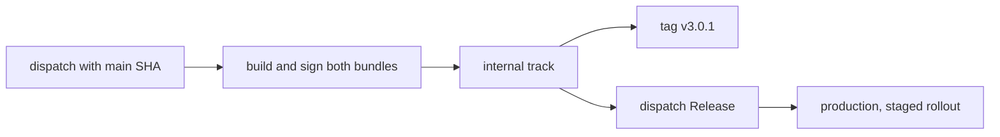

# Distribution

Both apps ship to Google Play from GitHub Actions, by manual dispatch from
`main`. A merge deploys nothing, and no workflow commits a version bump: the
version name comes from the dispatch, and Gradle derives both version codes
from it. [Gradle Play Publisher](https://github.com/Triple-T/gradle-play-publisher)
does every Google Play call; the workflows only check the ref and inputs, pass
secrets, and tag.

| Workflow                                                       | What it does                                                                                                                          |
| -------------------------------------------------------------- | ------------------------------------------------------------------------------------------------------------------------------------- |
| [Google Play Internal](../.github/workflows/play-internal.yml) | Has Claude write release notes, builds and signs both bundles, uploads them to the internal track as one release, and tags the commit |
| [Google Play Release](../.github/workflows/play-release.yml)   | Promotes the internal release to production, or changes the staged rollout of one already there; optionally replaces the listing      |



The workflow inputs are the source of truth for options. Both take
`expected_sha`, the full SHA of the current `main`:

```bash
sha="$(gh api repos/putdotio/putio-android/branches/main --jq .commit.sha)"
gh workflow run play-internal.yml --ref main -f expected_sha="$sha" -f version_name=3.0.1
gh workflow run play-internal.yml --ref main -f expected_sha="$sha" -f version_name=3.0.1 -f dry_run=true
gh workflow run play-release.yml --ref main -f expected_sha="$sha" -f rollout_percent=10
gh workflow run play-release.yml --ref main -f expected_sha="$sha" -f from_track=production -f rollout_percent=100
```

[Delivery ref](../.github/workflows/delivery-ref.yml) rejects any other ref, a
different SHA, a `main` that has moved, or a SHA whose push run of
[CI](../.github/workflows/ci.yml) has not passed, before a job loads secrets.
Later jobs check out that SHA. Both workflows share one concurrency group, so
runs queue instead of overlapping. Secrets come only from the `release`
Environment, which admits `main` alone.

The controls are dispatch-only workflows, the exact-SHA and CI checks, the
Environment's branch policy, full-SHA action pins, validated inputs, and fresh
installs without dependency caches in secret-bearing jobs.

## Dry runs

Internal with `dry_run` runs everything with the real secrets but passes
`--no-commit`: Google Play validates both bundles, their signing key and
version codes inside an edit that is never committed, and nothing is tagged. A local
release build without the secrets stays unsigned:

```bash
./gradlew -PputioVersionName=3.0.1 :mobile:bundleProductionRelease :tv:bundleProductionRelease
```

## One listing, two apps

Mobile and TV both ship as `io.put.putio`, the Android TV listing
[putio-tv-native-legacy](https://github.com/putdotio/putio-tv-native-legacy)
already publishes to, so they share its listing, signing and version codes.
Each internal upload is one release carrying both bundles, and Google Play
serves each device the highest code it can install. Phones and tablets lack
`android.software.leanback`, which TV requires, so they get mobile. TVs can
install either, since mobile requires no touchscreen, so TV takes the higher
code.

The internal track is the Compose app's alone; the legacy app uploads
production drafts.

## Versions

Both apps ship under one version name from the dispatch, 3.0.0 onwards after
the legacy app's 2.x. The
[application convention plugin](../build-logic/src/main/kotlin/PutioAndroidApplicationPlugin.kt)
reads it from the `putioVersionName` property and derives each code:

| Version | Mobile code | TV code |
| ------- | ----------- | ------- |
| 3.0.1   | 3000010     | 3000011 |
| 3.2.15  | 3020150     | 3020151 |

Google Play never takes a version code twice, so every upload needs a new
version name; a failed upload that Google Play rejected can reuse its name.
Codes up to 94 are taken by the legacy app and the first Compose upload.

Release promotes everything on the internal track, with all its version codes,
to production. A staged rollout leaves the rest of production on the release
it had; 100% replaces it. `from_track=production` only moves a staged rollout:
Gradle Play Publisher would restage a completed release instead of refusing.

## Signing

Google Play re-signs what users install with the app signing key it holds;
CI signs with the upload key, and Google Play rejects a bundle signed with any
other. The convention plugin signs release builds when `ANDROID_KEYSTORE_PATH`
is set and leaves them unsigned otherwise. Builds that sign run without the
configuration cache, so no signing password lands on disk.

Uploads also require `PUTIO_SENTRY_DSN`, since a release build without it
never starts Sentry, and `SENTRY_AUTH_TOKEN` with `SENTRY_PROJECT`: each build
then uploads its R8 mapping to that project in the `putio` Sentry organization
before Google Play sees the bundle, and a failed mapping upload fails the build
([Diagnostics](behavior.md#diagnostics)).

## Release tags

Internal tags the uploaded commit `v<version>` with an annotated tag after
Google Play accepts the upload. It tags as the `putio-ci` GitHub
App, with a token for this repository and `contents: write` alone, minted from
the Environment's `PUTIO_CI_APP_CLIENT_ID` variable and
`PUTIO_CI_APP_PRIVATE_KEY`.

## Release notes

No release notes are committed. Internal's `notes` job runs
[beta-notes](https://github.com/putdotio/.github#actionsbeta-notes) on the
changes since the latest `v*` tag, capped at Google Play's 500 characters.
The dry run writes notes too and shows them in its summary.

The upload job writes the notes to the ignored
`mobile/src/main/play/release-notes/en-US/internal.txt` just before Gradle
Play Publisher uploads. Release copies the internal release's notes to
production unchanged.

## Google Play as code

Gradle Play Publisher is applied to `mobile` for both apps and authenticates
with the service account key in `ANDROID_PUBLISHER_CREDENTIALS`.
`:mobile:publishProductionReleaseBundle` builds both bundles, collects them
with `syncPlayBundles`, and uploads them as one release. It owns these files
under [mobile/src/main/play](../mobile/src/main/play):

| Path                                  | Reaches Google Play                                                          |
| ------------------------------------- | ---------------------------------------------------------------------------- |
| `listings/en-US/*.txt` and `graphics` | Only through Google Play Release with `publish_listing`, which replaces them |

The listing mirrors the one the legacy app published.

## Release Environment

| Name                        | Kind     | Holds                                                    |
| --------------------------- | -------- | -------------------------------------------------------- |
| `ANDROID_KEYSTORE_BASE64`   | secret   | The upload keystore, base64                              |
| `ANDROID_KEYSTORE_PASSWORD` | secret   | Its store password                                       |
| `ANDROID_KEY_ALIAS`         | secret   | The upload key's alias                                   |
| `ANDROID_KEY_PASSWORD`      | secret   | The upload key's password                                |
| `PLAY_SERVICE_ACCOUNT_JSON` | secret   | The Google Play service account key                      |
| `PUTIO_CI_APP_PRIVATE_KEY`  | secret   | The `putio-ci` App's private key, for tags               |
| `PUTIO_CI_APP_CLIENT_ID`    | variable | The `putio-ci` App's client ID                           |
| `SENTRY_AUTH_TOKEN`         | secret   | A Sentry organization token, for R8 mapping uploads      |
| `PUTIO_SENTRY_DSN`          | variable | The Android Sentry project's DSN, embedded in the builds |
| `SENTRY_PROJECT`            | variable | That project's slug, for R8 mapping uploads              |
