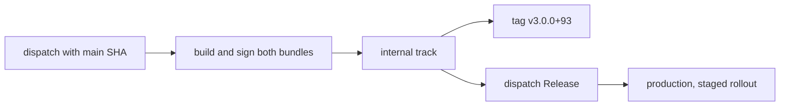

# Distribution

Both apps ship to Google Play from GitHub Actions, by manual dispatch from
`main`. A merge deploys nothing, and no workflow commits a version bump:
version names come from the dispatch, version codes from Google Play.

| Workflow                                                       | What it does                                                                                                                          |
| -------------------------------------------------------------- | ------------------------------------------------------------------------------------------------------------------------------------- |
| [Google Play Internal](../.github/workflows/play-internal.yml) | Has Claude write release notes, builds and signs both bundles, uploads them to the internal track as one release, and tags the commit |
| [Google Play Release](../.github/workflows/play-release.yml)   | Promotes the internal release to production, or changes the staged rollout of one already there; optionally replaces the listing      |



The workflow inputs are the source of truth for options. Both take
`expected_sha`, the full SHA of the current `main`:

```bash
sha="$(gh api repos/putdotio/putio-android/branches/main --jq .commit.sha)"
gh workflow run play-internal.yml --ref main -f expected_sha="$sha" -f version_name=3.0.0
gh workflow run play-internal.yml --ref main -f expected_sha="$sha" -f version_name=3.0.0 -f dry_run=true
gh workflow run play-release.yml --ref main -f expected_sha="$sha" -f version_code=<code> -f rollout_percent=10
gh workflow run play-release.yml --ref main -f expected_sha="$sha" -f version_code=<code> -f from_track=production -f rollout_percent=100
```

[Delivery ref](../.github/workflows/delivery-ref.yml) rejects any other ref, a
different SHA, a `main` that has moved, or a SHA whose push run of
[CI](../.github/workflows/ci.yml) has not passed, before a job loads secrets.
Later jobs check out that SHA. Both workflows share one concurrency group, so
runs queue instead of overlapping. Secrets come only from the `release`
Environment, which admits `main` alone.

The controls are dispatch-only workflows, the exact-SHA and CI checks, the
Environment's branch policy, full-SHA action pins, validated inputs, fresh
installs without dependency caches in secret-bearing jobs, and the signature
check below.

## Dry runs

Internal with `dry_run` builds without the release Environment or any secret
and uploads nothing. It signs both apps with a throwaway key and shows that the
signature check rejects them. The same check runs locally:

```bash
node scripts/play.ts build-check --version-name 3.0.0
```

Uploads, promotions and rollout changes refuse to run outside CI.

## One listing, two apps

Mobile and TV both ship as `io.put.putio`, the Android TV listing
[putio-tv-native-legacy](https://github.com/putdotio/putio-tv-native-legacy)
already publishes to, so they share its listing, signing and version codes.
Each internal upload is one release carrying both bundles, and Google Play
serves each device the highest code it can install. Phones and tablets lack
`android.software.leanback`, which TV requires, so they get mobile. TVs can
install either, since mobile requires no touchscreen, so TV takes the higher
code.

Compose builds go to the internal track only: the legacy app's release
promotes from the beta track and refuses one with more than one release.
The concurrency group covers this repository alone, so don't upload from both
repositories at once: the later upload fails on a taken version code and
changes nothing on Google Play.

## Versions

Both apps ship under one version name from the dispatch, 3.0.0 onwards after
the legacy app's 2.x. The upload reads every code Google Play has seen, on any
track and in every uploaded bundle or APK, and gives mobile the highest plus
one and TV the next; a `version_code` input sets mobile's code and must be
above that. Codes up to 92 are reserved for the legacy app's 2.13.0 beta.
Gradle reads the name and code from the `putioVersionName` and
`putioVersionCode` properties; the committed values are local defaults.

Release promotes the internal track's only release, with all its codes, and
only when it holds the `version_code` input. A promotion supersedes any older
staged production rollout. A staged rollout keeps the completed production
release everyone else gets; 100% replaces it.

## Signing

Google Play re-signs what users install with the app signing key it holds;
CI signs with the upload key. The
[application convention plugin](../build-logic/src/main/kotlin/PutioAndroidApplicationPlugin.kt)
signs release builds when `ANDROID_KEYSTORE_PATH` is set and leaves them
unsigned otherwise. The upload refuses to run unless both bundles and APKs are
signed only by `UPLOAD_CERT_SHA256` in [play.ts](../scripts/play.ts), the
upload certificate Google Play holds, with every bundle entry signed. Builds that sign run without the
configuration cache, so no signing password lands on disk.

Uploads also require `PUTIO_SENTRY_DSN`, since a release build without it
never starts Sentry, and `SENTRY_AUTH_TOKEN` with `SENTRY_PROJECT`: each build
then uploads its R8 mapping to that project in the `putio` Sentry organization
before Google Play sees the bundle, and a failed mapping upload fails the build
([Diagnostics](behavior.md#diagnostics)).

## Release tags

Internal tags the uploaded commit `v<version>+<mobile code>` after Google Play
accepts the upload, with an annotated tag whose message carries
`Mobile-Version-Code` and `TV-Version-Code`. It tags as the `putio-ci` GitHub
App, with a token for this repository and `contents: write` alone, minted from
the Environment's `PUTIO_CI_APP_CLIENT_ID` variable and
`PUTIO_CI_APP_PRIVATE_KEY`.

## Release notes

No release notes are committed. Internal's `notes` job runs the shared
[beta-notes](https://github.com/putdotio/.github#actionsbeta-notes) action:
Claude reads the pull requests and code changed since the base tag and writes
bullets that fit Google Play's 500 characters. The base is the latest
`v*` tag below the shipped commit whose version name differs from the
dispatch's, so every build of 3.0.1 describes all changes since the last
3.0.0 upload. With no such tag, no user-facing commits, or any Claude failure,
the notes are "Bug fixes and improvements." The dry run writes notes too and
shows them in its summary.

The upload job writes the notes to
`mobile/src/main/play/release-notes/en-US/internal.txt`, an ignored path,
just before Gradle Play Publisher uploads. Release copies the internal
release's notes to production unchanged.

| Since the base tag                       | Notes                               |
| ---------------------------------------- | ----------------------------------- |
| `feat`, `fix` or `perf` commits          | Claude's bullets, one `- ` per line |
| Only tooling, docs or dependency commits | Bug fixes and improvements.         |
| No base tag, or Claude fails             | Bug fixes and improvements.         |

## Google Play as code

[Gradle Play Publisher](https://github.com/Triple-T/gradle-play-publisher),
applied to `mobile` for both apps, talks to Google Play with the service
account key in `ANDROID_PUBLISHER_CREDENTIALS`;
[google-play.ts](../scripts/google-play.ts) reads version codes and changes the
production track with the same key. Its promotion would keep one code per
release and drop the other app's. Gradle Play Publisher owns these files under
[mobile/src/main/play](../mobile/src/main/play):

| Path                                  | Reaches Google Play                                                          |
| ------------------------------------- | ---------------------------------------------------------------------------- |
| `listings/en-US/*.txt` and `graphics` | Only through Google Play Release with `publish_listing`, which replaces them |

The listing mirrors the one the legacy app published. The upload stages only
the bundles it built and checked for `--artifact-dir`, so nothing is rebuilt
between the signature check and the upload.

## Release Environment

| Name                        | Kind     | Holds                                                    |
| --------------------------- | -------- | -------------------------------------------------------- |
| `ANDROID_KEYSTORE_BASE64`   | secret   | The upload keystore, base64                              |
| `ANDROID_KEYSTORE_PASSWORD` | secret   | Its store password                                       |
| `ANDROID_KEY_ALIAS`         | secret   | The upload key's alias                                   |
| `ANDROID_KEY_PASSWORD`      | secret   | The upload key's password                                |
| `PLAY_SERVICE_ACCOUNT_JSON` | secret   | The Google Play service account key                      |
| `PUTIO_CI_APP_PRIVATE_KEY`  | secret   | The `putio-ci` App's private key, for tags               |
| `PUTIO_CI_APP_CLIENT_ID`    | variable | The `putio-ci` App's client ID                           |
| `SENTRY_AUTH_TOKEN`         | secret   | A Sentry organization token, for R8 mapping uploads      |
| `PUTIO_SENTRY_DSN`          | variable | The Android Sentry project's DSN, embedded in the builds |
| `SENTRY_PROJECT`            | variable | That project's slug, for R8 mapping uploads              |
